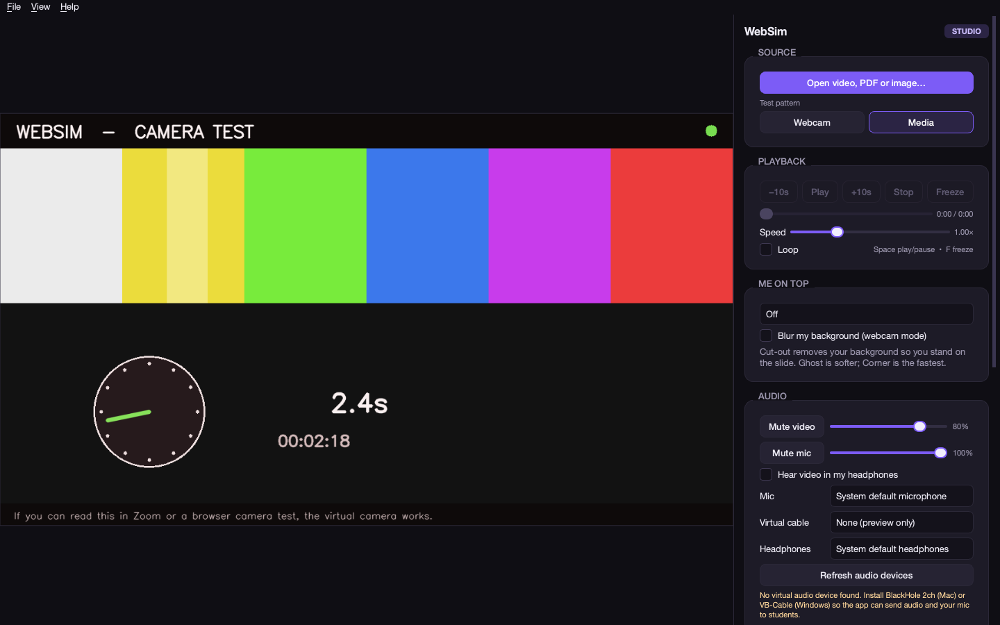

# WebSim

**A virtual webcam studio for tutors.**

Play videos, PDFs and images into any call, with you on top of the slide, a
blur box for hiding answers, freeze, and a virtual microphone that mixes the
lesson audio with your real voice.



[](https://www.python.org/)
[](#requirements)
[](LICENSE)
[](https://docs.astral.sh/uv/)

WebSim is a desktop app that shows up in **Zoom, Meet, Teams, Discord and browser
webcam sites** as a camera and a microphone. You drive it from its own window; the
call app only sees the result.

---

## Highlights

- **One camera feed for everything.** Videos (all FFmpeg formats), PDFs and images
  are rendered at 1280×720 / 30 fps into a system-wide virtual camera.
- **You on top.** Cut-out (background removed, weather-presenter style), ghost
  (see-through) or corner (picture-in-picture) — plus one-key freeze.
- **Blur that hides answers.** Gaussian, pixelate, box, motion, frosted glass or
  blackout. Apply it to the whole frame or drag a box over just one part.
- **Audio that just works.** Video sound and your real microphone are mixed into a
  virtual cable. Separate volumes and mutes for each, plus optional headphone
  monitoring.
- **Keyboard-first.** Every action has an in-app shortcut, and the important ones
  work globally while the call app is focused.
- **Fails politely.** No OBS? Preview-only with a clear banner. No camera? It says
  so. No virtual audio device? It tells you what to install.

---

## Requirements

| What | Why |
|---|---|
| **macOS 13+ or Windows 10/11** (64-bit) | The app itself |
| **OBS Studio 30+** | Installs the virtual camera driver. OBS does **not** need to run afterwards. |
| **BlackHole 2ch** (macOS) or **VB-Audio Virtual Cable** (Windows) | Provides the virtual microphone |
| Internet on first launch | `uv` downloads Python 3.12 and the dependencies |

Python, FFmpeg and the Python packages are installed automatically by the start
script. You do **not** need to install Python or FFmpeg yourself.

---

## Quick start

### macOS

```bash
git clone <your-repo-url> websim
cd websim
./start.command          # or double-click it in Finder
```

The first run installs `uv`, Python 3.12 and the app (~300 MB). Later launches are
fast. If macOS refuses to open `start.command`, right-click → **Open**, or run
`chmod +x start.command` once.

### Windows

1. Download / clone this folder.
2. Double-click **`start.bat`**.

The script installs `uv` and Python if needed, syncs the dependencies and starts
WebSim. No admin rights are needed for the app itself; OBS and VB-Cable have their
own installers.

No Git? Use **Code → Download ZIP** on GitHub, unzip the folder, and run the same
launcher.

### First-run permissions

- **macOS:** allow **Camera** and **Microphone** for your terminal app (the window
  that launches WebSim). Global shortcuts also need **Accessibility**.
  System Settings → Privacy & Security → Camera / Microphone / Accessibility.
- **Windows:** Settings → Privacy → Camera / Microphone → allow desktop apps.

Restart WebSim after changing permissions.

---

## One-time setup

### 1. Virtual camera — OBS Studio

Python cannot create a camera by itself. WebSim uses `pyvirtualcam`, which talks to
the virtual camera that OBS installs.

1. Install [OBS Studio 30+](https://obsproject.com/).
2. Open OBS **once**.
3. Click **Start Virtual Camera**, wait a second, then **Stop**.
4. Quit OBS.

That is all OBS is needed for. It will never record, stream or show up in your
call. Other apps will see WebSim's output as **“OBS Virtual Camera.”**

> macOS may ask you to approve OBS's system extension. Approve it in
> System Settings → Privacy & Security, then restart if prompted.

### 2. Virtual microphone — BlackHole or VB-Cable

**macOS:** install [BlackHole 2ch](https://existential.audio/blackhole/). It needs
an admin password and a system-extension approval.

**Windows:** install [VB-Audio Virtual Cable](https://vb-audio.com/Cable/) as
administrator, then reboot.

Then wire it up like this:

| Where | Camera | Microphone |
|---|---|---|
| **WebSim** → *Virtual cable* | — | BlackHole 2ch / `CABLE Input` |
| **WebSim** → *Mic* | — | your real microphone |
| **Zoom / Meet / browser** → camera | **OBS Virtual Camera** | — |
| **Zoom / Meet / browser** → mic | — | BlackHole 2ch / `CABLE Output` |

Why the two names? On Windows, `CABLE Input` is the playback side WebSim writes
to, and `CABLE Output` is the recording side Zoom reads from. BlackHole exposes
both sides under one name.

**WebSim must be running for students to hear you**, because it is the thing
mixing your microphone into the virtual cable.

### 3. Check it

1. Start WebSim.
2. Choose **File → Camera test pattern (with tone)**.
3. In Zoom or a browser camera test, pick **OBS Virtual Camera** and
   BlackHole / CABLE Output.
4. You should see moving colour bars and a running clock, and the 440 Hz tone
   should move the microphone meter.

---

## Using WebSim

- **Open video, PDF or image…** or drag a file onto the window.
- **Webcam / Media** switches between your camera and the lesson.
- **Playback:** play/pause, stop, ±10 s, seek bar, speed 0.25×–3×, loop.
- **Freeze** pauses the video and puts you on top in one key; press again to carry on.
- **Me on top:** Cut-out, Ghost, Corner or Off.
- **Blur:** pick a style, choose *Whole frame* or *Drawn box*, then drag a rectangle
  on the preview. Right-click the preview (or press Esc) to clear it.
- **Audio:** separate volume and mute for video and mic; optional headphone monitor
  (video only, so it cannot feed back).
- **Always on top** keeps the control panel over Zoom.
- **Global shortcuts** work while the call app is focused (optional).

### Keyboard shortcuts

| Action | In app | Global |
|---|---|---|
| Play / pause | `Space` | `Ctrl+Alt+Space` |
| Stop (back to start, paused) | `S` | `Ctrl+Alt+S` |
| Back / forward 10 s | `←` / `→` | `Ctrl+Alt+←` / `→` |
| Slower / faster | `↓` / `↑` | `Ctrl+Alt+↓` / `↑` |
| Loop | `L` | — |
| Freeze + me on top | `F` | `Ctrl+Alt+F` |
| Pointing style | `P` | — |
| Webcam / media | `C` / `V` | `Ctrl+Alt+C` / `V` |
| Blur on/off | `B` | `Ctrl+Alt+B` |
| Change blur type | `Shift+B` | — |
| Mute video audio | `M` | `Ctrl+Alt+M` |
| Mute mic | `N` | `Ctrl+Alt+N` |
| PDF previous / next page | `PgUp` / `PgDn` | `Ctrl+Alt+PgUp` / `PgDn` |
| Clear blur box | `Esc` | — |

On macOS, `Ctrl+Alt` means `Ctrl+Option`.

### Blur styles

| Style | Best for |
|---|---|
| Gaussian | Soft, natural blur |
| Pixelate | Mosaic; hides text without hiding the layout |
| Box | Fastest blur; low-end machines |
| Motion | Streaky directional blur |
| Frosted glass | Soft blur with a glass-like haze |
| Blackout | Solid cover for answers or private material |

---

## How it works

```
video / PDF / image ─┐
                     ├─ 30 fps composer ── blur ── presenter overlay ──► OBS Virtual Camera
webcam ──────────────┘                                                        │
                                                                              ▼
video sound ──┐                                                         Zoom / Meet / browser
              ├─ audio mixer (48 kHz stereo) ─────────────────────────► BlackHole / VB-Cable
real mic ─────┘
```

- **UI:** PySide6.
- **Video + audio decode:** PyAV / FFmpeg.
- **PDF:** pypdfium2.
- **Camera:** OpenCV + `cv2-enumerate-cameras` (the OBS camera is hidden from the
  picker so WebSim cannot feed into itself).
- **Background removal:** MediaPipe person segmentation, in its own thread.
- **Virtual camera:** pyvirtualcam (OBS driver), 1280×720 @ 30 fps.
- **Audio:** sounddevice; the virtual cable gets video sound + mic, headphones get
  video only.
- **Global keys:** pynput.

Heavy work (video decode, audio decode, segmentation, output timing) runs off the
UI thread, so the control panel stays responsive.

---

## Diagnostics

```bash
uv run websim --doctor
```

The report checks the virtual camera, cameras, audio devices, virtual-cable
detection and background-removal model. It prints exactly which piece is missing.

Other useful flags:

```bash
uv run websim --test-pattern        # test card + 440 Hz tone
uv run websim --preview-only        # never open the virtual camera
uv run websim --no-global-shortcuts # for troubleshooting
uv run websim --verbose             # debug logging
```

Logs live in `.websim/logs/websim.log` inside the project folder.

---

## Troubleshooting

**“Virtual camera unavailable” banner.** OBS is not installed, or its virtual
camera was never started once. Install OBS 30+, open it, Start Virtual Camera,
Stop, quit OBS, then click **Retry virtual camera** in WebSim.

**Preview works but Zoom/browser shows black or frozen.** Select **OBS Virtual
Camera** in that app. Close OBS. On macOS check the camera permission for your
terminal; on Windows check Settings → Privacy → Camera. Restart the app that is
reading the camera after WebSim starts.

**No sound reaches students.** Check, in order: (1) WebSim → *Virtual cable* is
BlackHole / CABLE Input; (2) Zoom's mic is BlackHole / CABLE Output; (3) WebSim's
mic is your **real** microphone, not the cable; (4) nothing is muted in WebSim.
The mic meter in Zoom should move when you speak. If the test tone sounds choppy,
turn off Zoom's background-noise suppression for that microphone — it can mistake
a steady tone for noise.

**I hear nothing in my headphones.** Monitoring is off by default. Tick **Hear
video in my headphones** and pick your headphones. Monitoring never carries your
mic, so it cannot howl.

**Cut-out is slow.** Use **Ghost** or **Corner** (they need no background-removal
model), close other heavy apps, or use a 720p camera. WebSim always outputs
1280×720 / 30 fps.

**Global shortcuts do nothing (macOS).** Grant **Accessibility** permission to
your terminal app, then restart WebSim or toggle the shortcut checkbox off/on.

**Camera says “Waiting for the camera”.** Another app may hold it. Quit Zoom /
Photo Booth, click **Refresh cameras**, pick it again. If permission was denied,
allow it in System Settings and restart WebSim.

**Start script fails on first run.** It needs internet for `uv`, Python 3.12 and
the packages. Check the log printed in the window; details are in
`.websim/logs/websim.log`.

---

## Development

```bash
uv sync
uv run websim
uv run websim --test-pattern
uv run websim --doctor
uv run pytest
uv run ruff check
```

Project layout:

```
src/websim/
  app.py            command line + Qt bootstrap
  studio.py         app state and the 30 fps output loop
  audio.py          timelines, mic capture, virtual-cable mixer, video sound
  compose.py        cut-out / ghost / corner / background blur
  blur.py           blur styles
  segmenter.py      MediaPipe person segmentation (background thread)
  output.py         pyvirtualcam sink
  shortcuts.py      pynput global hotkeys
  config.py         persisted settings
  sources/          video, PDF, images, webcam, test card
  ui/               preview, control panel, main window, theme
tests/              headless test suite (44 tests)
start.command       macOS launcher
start.bat           Windows launcher
plan.md             original design brief
PROGRESS.md         implementation status
```

The test suite runs headless (`QT_QPA_PLATFORM=offscreen`), uses no real camera or
audio output, and writes only inside `tests/_artifacts/`.

### Contributing

Issues and pull requests are welcome. Please run `uv run ruff check` and
`uv run pytest` before opening a PR. Help with **Windows and real Zoom/browser
testing** is especially useful — see `PROGRESS.md` for the remaining checklist.

---

## Status and limitations

Verified on macOS: UI, live camera composition, MediaPipe segmentation, microphone
capture, video/PDF/image sources, and the audio mixer logic. The virtual-camera and
virtual-microphone paths need OBS and BlackHole/VB-Cable installed; Windows needs a
clean-machine test. See `PROGRESS.md`.

Not in v1: drawing/annotations, playlists, YouTube links, green screen, recording,
and a custom branded camera driver (which would require code signing and a driver
of our own).

WebSim is a desktop app. It is not affiliated with websim.ai.

---

## License

MIT — see [LICENSE](LICENSE).

Built on the shoulders of [OBS Studio](https://obsproject.com/),
[BlackHole](https://existential.audio/blackhole/),
[VB-Audio Virtual Cable](https://vb-audio.com/Cable/),
[PyAV](https://pyav.org/), [MediaPipe](https://ai.google.dev/edge/mediapipe/solutions/guide),
[PySide6](https://doc.qt.io/qtforpython-6/),
[pyvirtualcam](https://github.com/letmaik/pyvirtualcam),
[pypdfium2](https://github.com/pypdfium2-team/pypdfium2),
[sounddevice](https://python-sounddevice.readthedocs.io/) and
[pynput](https://pynput.readthedocs.io/).
